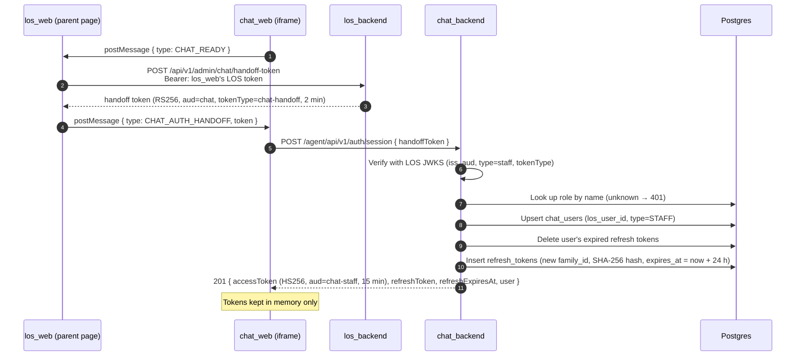
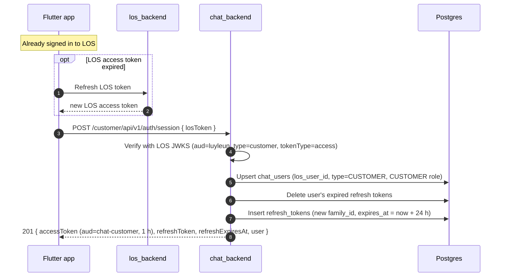
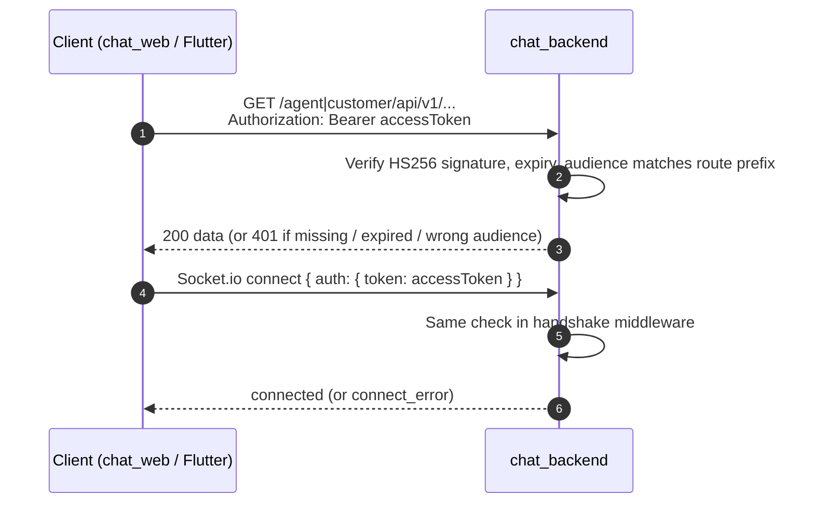
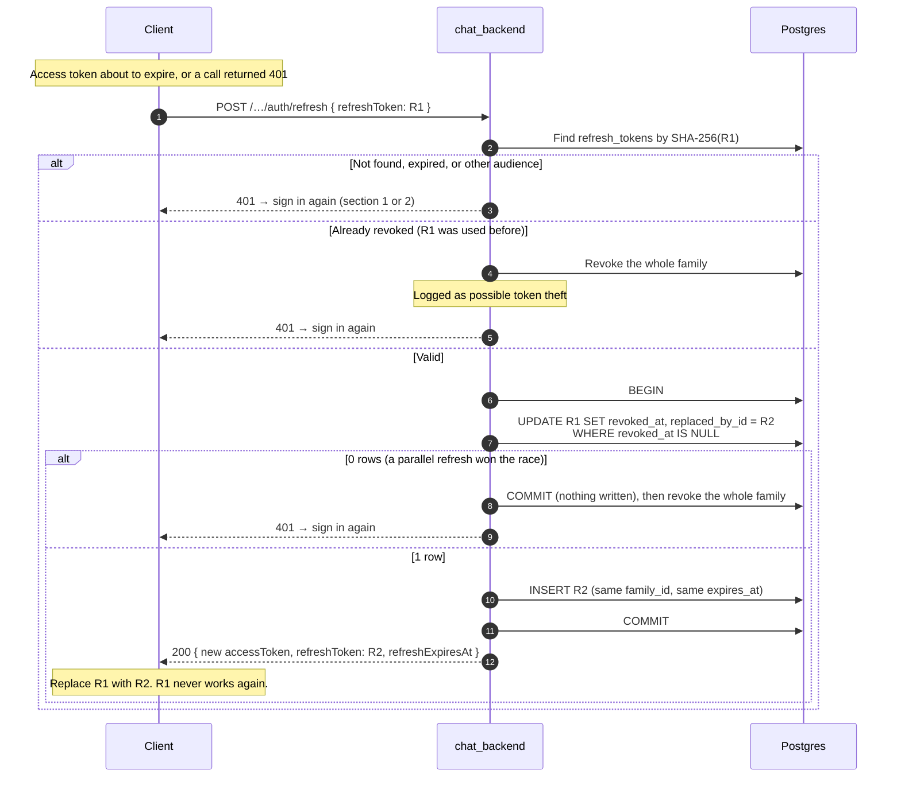
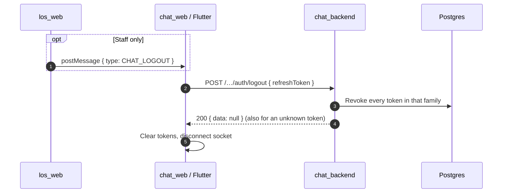
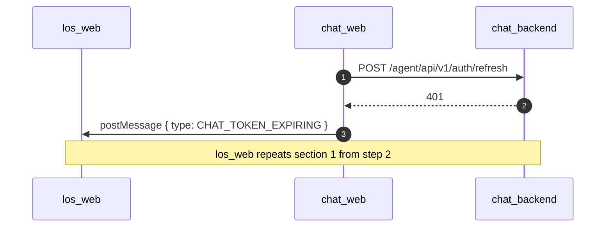

# Auth sequence diagrams

How chat sign-in works, step by step. The rules and payloads are in [los-chat-handoff.md](los-chat-handoff.md); this page only shows the order of calls.

Lifetimes: staff access token **15 min**, customer access token **1 h**, refresh token **24 h from sign-in** (refreshing never extends it).

## 1. Staff sign-in (los_web → chat_web)

## 2. Customer sign-in (Flutter)

## 3. Using the session (REST and Socket.io)

## 4. Refresh (rotation and reuse detection)

## 5. Logout

## 6. Staff session lost (reload or 24 h limit)

